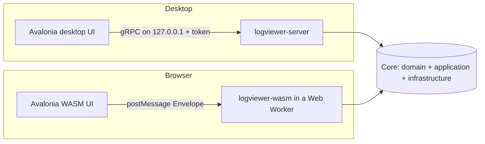

# LogViewer

[](https://github.com/8alex62/LogViewer/actions/workflows/core.yml?query=branch%3Adevelop)
[](LICENSE)

A fast, privacy-first viewer for large log files, on desktop (Windows, Linux) and in the browser.

> **Status:** early development (Sprint 1, *Core foundations*). The Rust Core is scaffolded as a walking skeleton; reading files, gRPC and the UI come with the next stories.

## Goals

- Open multi-gigabyte log files instantly: files are indexed by line offsets and read by ranges, never loaded whole in memory.
- Filter by level, date range, keyword or regex, search, bookmark and merge several files by timestamp.
- **Privacy:** log files never leave the user's machine. In the browser they are read in place by a Web Worker; nothing is uploaded and nothing is persisted unless the user opts in ([ADR 0005](docs/adr/0005-privacy-logs-never-leave-the-machine.md)).

## Tech stack

| Area | Technology |
|---|---|
| Core | Rust 1.100 (edition 2024), Cargo workspace, `thiserror` |
| Desktop transport | gRPC with Protocol Buffers (`tonic` / `prost`), Core runs as a sidecar on `127.0.0.1` |
| Web transport | Core compiled to `wasm32-unknown-unknown` (`wasm-bindgen`) in a Web Worker, protobuf `Envelope` over `postMessage` |
| Contract | `proto/` linted with [`buf`](https://buf.build) (STANDARD rules) |
| UI | C# / [Avalonia](https://avaloniaui.net) (desktop and WASM), MVVM *(not scaffolded yet)* |
| CI | GitHub Actions: fmt, clippy, tests on Linux + Windows, WASM build, `buf lint` |

The reasons behind these choices are recorded in the [ADRs](docs/adr/README.md).

## Architecture

Two components share one Protocol Buffers contract; only the transport depends on the deployment mode.



The Core follows Clean Architecture, one crate per layer; dependencies only point inward:

| Layer | Crate | Responsibility |
|---|---|---|
| Domain | `logviewer-domain` | Entities: `LogEntry`, `LogLevel`, `Filter` |
| Application | `logviewer-application` | Use cases and ports (`LogSource`, `LogParser`) |
| Infrastructure | `logviewer-infrastructure` | Line index, parsers, format detection; readers behind the `native` / `browser` features |
| Presentation (desktop) | `logviewer-server` (bin) | gRPC service, composition root |
| Presentation (web) | `logviewer-wasm` (cdylib) | `wasm-bindgen` entry point, composition root |

Layer rules and details: [docs/architecture.md](docs/architecture.md).

## Repository layout

| Path | Content |
|---|---|
| `core/` | Rust Core: Cargo workspace, crates under `core/crates/` |
| `proto/` | Protocol Buffers contract (`logviewer/v1/`) shared by the Core and the client |
| `docs/` | Specs pointer, architecture summary, [ADRs](docs/adr/README.md) |
| `samples/` | Synthetic log files for tests and demos ([rules](samples/README.md)) |
| `.github/` | CI workflow, issue and PR templates |

## Getting started

### Prerequisites

- [rustup](https://rustup.rs). The toolchain (Rust 1.100 with `rustfmt`, `clippy` and the `wasm32-unknown-unknown` target) is pinned in `core/rust-toolchain.toml` and installed automatically on the first `cargo` command in `core/`.
- [Git](https://git-scm.com).
- Optional: the [`buf` CLI](https://buf.build/docs/installation) to lint the proto contract.
- Later: the .NET SDK for the Avalonia client.

### Clone and build

```bash
git clone https://github.com/8alex62/LogViewer.git
cd LogViewer/core
cargo build --workspace
```

### Run

```bash
cd core
cargo run -p logviewer-server   # desktop sidecar (prints its version for now)
cargo build -p logviewer-wasm --target wasm32-unknown-unknown   # web Core
```

## Tests and quality checks

Run from `core/`. These are the same commands as the CI, so a green run locally means a green CI:

```bash
cargo fmt --all -- --check
cargo clippy --workspace --all-targets --all-features -- -D warnings
cargo test --workspace --all-features
cargo clippy -p logviewer-wasm --target wasm32-unknown-unknown -- -D warnings
```

Test a single crate with `cargo test -p logviewer-infrastructure`. Lint the contract from the repository root with `buf lint`.

## Contributing

Branch model, commit conventions (gitmoji) and the PR checklist are in [CONTRIBUTING.md](CONTRIBUTING.md). Work is tracked in Fibery (user stories `US-n`, tasks `T-n`).

### AI agent tooling

Optional: install [Repowise](https://docs.repowise.dev) (`uv tool install repowise`, then `repowise init` at the repo root) to give AI coding agents a local index of the codebase; `.claude/CLAUDE.md` and `.github/copilot-instructions.md` expect it.

## License

[Apache 2.0](LICENSE)
