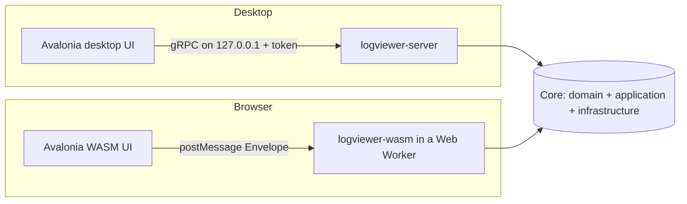
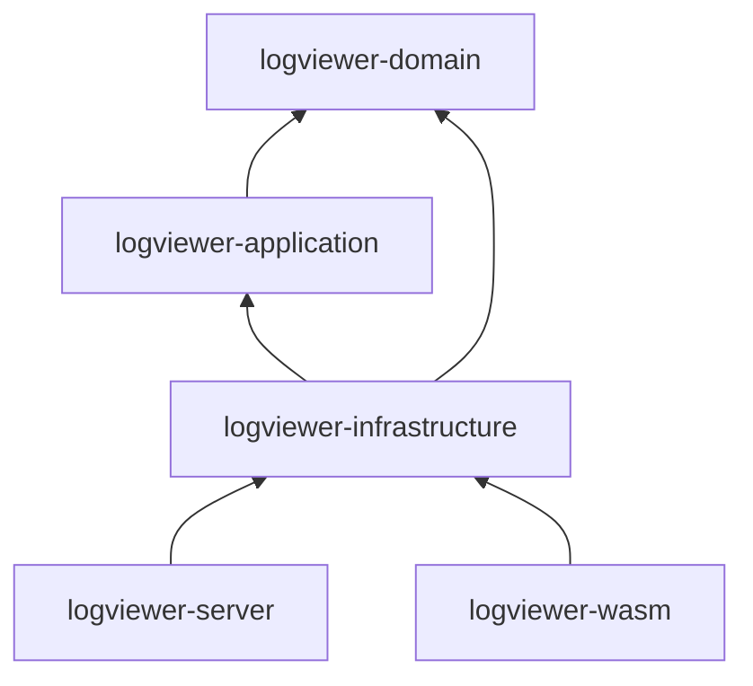

# Architecture

> Source of truth: the LogViewer specs in Fibery (§4 Architecture, §7 Repository Structure).
> This page summarizes what the code must respect; update both together.

## Overview

Two components share one Protocol Buffers contract (`/proto`); only the transport depends on the deployment mode.

- **Core (Rust, `core/`)**: reads, indexes, parses, filters and searches logs.
- **Client (C# / Avalonia, `client/`)**: MVVM UI, client of the Core. *(not scaffolded yet)*

## Core: Clean Architecture

| Layer | Crate | Responsibility | May depend on |
|---|---|---|---|
| Domain | `logviewer-domain` | Entities: `LogEntry`, `LogLevel`, `LogFormat`, `Filter` | nothing |
| Application | `logviewer-application` | Use cases (`OpenFile`, `GetLines`, `Filter`, `Search`, `Tail`) and ports (`LogSource`, `LogParser`) | domain |
| Infrastructure | `logviewer-infrastructure` | Line index, parsers, format detection; readers behind features `native` / `browser` | application, domain |
| Presentation (desktop) | `logviewer-server` (bin) | gRPC (tonic), token check, proto ↔ domain mapping, composition root | all, `native` |
| Presentation (web) | `logviewer-wasm` (cdylib) | `wasm-bindgen` entry point, envelope dispatch, proto ↔ domain mapping, composition root | all, `browser` |

### Rules

1. Dependencies only point inward (down the table). The domain has no dependency at all.
2. The application layer talks to files only through the `LogSource` port, so the same use cases run on desktop and in WASM.
3. Platform code (`memmap2`, `notify`, `web-sys`…) lives only in `logviewer-infrastructure`, behind the `native` or `browser` feature.
4. Transport code (`tonic`, `prost`, `wasm-bindgen`) lives only in the presentation crates.
5. Libraries return typed errors (`thiserror`); only binaries may use `anyhow`.

## Contract

`proto/logviewer/v1/logviewer.proto` defines `LogViewerService`; `worker.proto` defines the `Envelope` used by the web transport. Names follow the `buf` STANDARD lint rules (`*Request` / `*Response`, `*_UNSPECIFIED = 0`), so `LinesPage` and `Match` from the specs are `GetLinesResponse` and `SearchResponse`.

## Privacy

Log files never leave the user's machine. In web mode they are read in place by the browser worker; nothing is uploaded or persisted (see ADR 0003 and ADR 0005).
